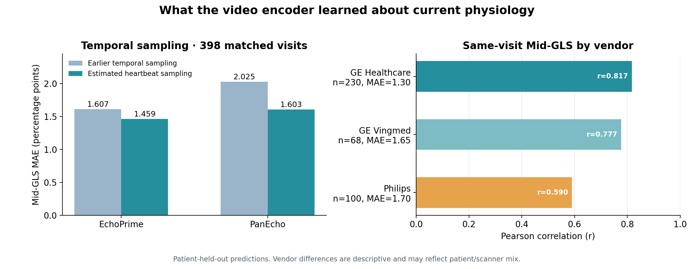
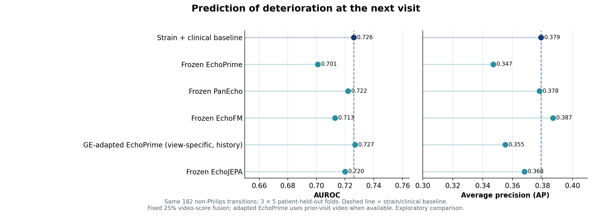

היי דן,
מקווה שהכנס מוצלח ועובר בנעימים.

רציתי לסכם את העבודה שעשיתי מאז שקיבלתי את הדאטה סט החדש מאיכילוב - התחלנו לדבר על זה בפגישה האחרונה. המטרה הייתה לבדוק אם אפשר להשתמש בסרטוני האקו כדי לשפר את חיזוי ההידרדרות בביקור הבא, מעבר למידע שכבר יש לי מהנתונים הקליניים ומעקומות ה-strain. הגדרתי הידרדרות כהופעה ראשונה בביקור הבא של ירידה יחסית של לפחות 15% ב-Mid-GLS לעומת ביקור הבסיס. בכל הניסויים שמרתי על חלוקה לפי מטופלים, כך שמטופל שנבדק לא הופיע באימון.

קודם הייתי צריך להבין אילו סרטונים שייכים לכל דוח. קיבלתי 416 דוחות strain, שמייצגים 400 ביקורים של 103 מטופלים לאחר איחוד אנליזות חוזרות של אותו ביקור. ב-DICOM היו 413 ביקורים: 239 של GE Healthcare, ‏70 של GE Vingmed ו-104 של Philips. בחרתי שלושה סרטונים לכל אחד מ-411 ביקורים, בזוויות A2C, A3C ו-A4C — בסך הכול 1,233 סרטונים. ל-398 מתוך 400 ביקורי ה-strain מצאתי התאמה מדויקת לפי מטופל, תאריך ו-Study UID. לשני ביקורים אין סט סרטונים תואם, ול-13 ביקורי DICOM אין דוח strain.

כדי למצוא את שלוש הזוויות השתמשתי ב-TOMTEC bookmark כשהיה אפשר לזהות ממנו את הסרטונים ששימשו לאנליזה. במקרים האחרים נעזרתי בסיווג זוויות ובבדיקה ידנית. לאחר מכן ביצעתי crop וקידוד של הסרטונים, ויישרתי את הווידאו עם נתוני ה-strain והנתונים הקליניים לפי ביקור.

בשלב הראשון בדקתי אם embeddings מוכנים של EchoPrime ו-PanEcho (מקודדי וידאו מאומני בדיקות אקו) מוסיפים מידע לחיזוי הידרדרות בביקור הבא. בסט המלא היו 238 מעברים לביקור הבא ו-49 אירועי הידרדרות. מודל הייחוס, שמשתמש ב-strain curves ובנתונים קליניים (CNN+MOMENT), הגיע ל-AUROC של 0.698 ול-AP של 0.353. כששילבתי 25% מתחזית EchoPrime באמצעות late fusion, קיבלתי AUROC של 0.694 ו-AP של 0.330. כלומר, בשלב הזה הווידאו לא שיפר את התוצאה.

בדגימה הראשונה לקחתי מכל סרטון עד ארבעה חלונות במיקומים שונים, עם 16 פריימים בכל חלון, ומיצעתי את ה-embeddings שלהם. המרווח בין הפריימים היה קבוע לכל מודל, בלי להתחשב בדופק או במשך הפעימה באותו סרטון. חשבתי שבגלל זה חלק מהחלונות עלולים לכלול רק חלק מהכיווץ וההרפיה, ולפספס מידע חשוב על תנועת הלב. לכן שיניתי את הדגימה כך ש-16 הפריימים בכל חלון יתפרשו על פני פעימה *משוערת* לפי הדופק וזמני הפריימים; עדיין לקחתי עד ארבעה חלונות מכל סרטון ומיצעתי את ה-embeddings שלהם. זו לא דגימה שמסונכרנת ל-ECG, אבל היא אמורה לתת ייצוג טוב יותר של שלבי הפעימה. השינוי עזר לחיזוי ה-Mid-GLS *באותו ביקור*: ב-EchoPrime ה-MAE ירד מ-1.607 ל-1.459 נקודות GLS, וב-PanEcho מ-2.025 ל-1.603, על 398 ביקורים. הקורלציה של EchoPrime עם Mid-GLS הייתה בערך 0.76. אבל בחיזוי ההידרדרות בביקור הבא לא היה שיפור ברור: בשילוב EchoPrime ה-AUROC השתנה מ-0.694 ל-0.690 וה-AP מ-0.330 ל-0.333.

בדקתי גם איפה המודל טועה. ב-GE Healthcare חיזוי ה-GLS היה טוב יותר, עם קורלציה של 0.817 ו-MAE של 1.30, לעומת קורלציה של 0.590 ו-MAE של 1.70 ב-Philips. זה לא בהכרח אומר שהיצרן הוא הסיבה; יכול להיות שיש הבדלים גם במכשירים, באיכות הסרטונים או באוכלוסיית המטופלים. כדי לנסות להבין את הפער בדקתי כמה הסברים: ב-16 ביקורים היו שתי אנליזות strain, והשגיאה בהם הייתה גבוהה יותר, אבל אלה מעט ביקורים ורובם לא של Philips. בדקתי גם אם המודל טועה יותר כשערכי ה-GLS בשלוש הזוויות רחוקים זה מזה או כשעקומות ה-strain שונות זו מזו, ולא מצאתי קשר משמעותי. לבסוף נתתי למודל גם את זהות יצרן המכשיר, אבל הדיוק כמעט לא השתנה. לכן עדיין לא ברור מה גורם לפער בביצועים בין GE ל-Philips.

כדי לבדוק אם סרטוני Philips מסתירים תרומה של הווידאו, הרצתי את הניסויים שוב רק על ביקורים שאינם של Philips. בתת-הקבוצה הזאת היו 182 מעברים של 86 מטופלים, מהם 38 אירועי הידרדרות. מודל ה-strain והנתונים הקליניים הגיע ל-AUROC של 0.726 ול-AP של 0.379. כל תוצאות החיזוי בהמשך הן על אותה תת-קבוצה מהדאטה סט הנוכחי.

קודם השוויתי בין ארבעה מקודדי וידאו קיימים — EchoPrime, PanEcho, EchoFM ו-EchoJEPA — בלי לאמן אותם מחדש. רציתי לבדוק אם הייצוג של אחד מהם מתאים יותר למטרה שלנו. למשל, שילוב EchoFM עם מודל הייחוס נתן AUROC של 0.713 ו-AP של 0.387, ושילוב EchoJEPA נתן 0.720 ו-0.368. אף אחד מהם לא שיפר באופן ברור את מודל הייחוס.

לאחר מכן ניסיתי להתאים את EchoPrime לסרטוני האקו שלנו באמצעות אימון self-supervised. לצורך אימון המקודד השתמשתי בסרטוני GE מהדאטה סט הנוכחי וגם מהדאטה סט הישן שכבר היה אצלנו; הדאטה הישן שימש רק לאימון המקודד, ולא להערכת החיזוי. אימנתי שתי גרסאות: מודל משותף לשלוש הזוויות (A2C, A3C, A4C) ומודלים נפרדים לכל זווית. בשילוב היסטוריית וידאו, המודל המשותף הגיע ל-AUROC של 0.710 ו-AP של 0.360, והמודלים הנפרדים הגיעו ל-0.727 ו-0.355. גם כאן לא התקבל שיפור ברור לעומת מודל ה-strain והנתונים הקליניים.

ניסיתי גם לבדוק אם עדיף להשתמש רק בחלק משלוש הזוויות. כשבדקתי בדיעבד את כל צירופי הזוויות, A3C+A4C עם EchoPrime מותאם נראה הכי מבטיח: AUROC של 0.736, אבל AP של 0.355. הבעיה היא שבדיקה כזאת עלולה להיראות טובה מדי, כי הצירוף נבחר אחרי שראיתי את התוצאות על אותם מטופלים. לכן עשיתי בדיקה מחמירה יותר: בכל חלוקת מטופלים בחרתי את הזוויות לפי נתוני האימון בלבד, ורק אז בדקתי את הצירוף שנבחר על מטופלים שהמודל לא ראה. בדרך הזאת קיבלתי AUROC של 0.707 ו-AP של 0.345. ניסיתי באותה צורה גם לבחור כמה משקל לתת לווידאו לעומת שאר המידע, וגם זה לא שיפר את החיזוי. לכן אני לא מתייחס ל-0.736 כשיפור מוכח.

מה שאני לוקח מהניסויים עד עכשיו הוא שהווידאו כן מכיל מידע על מצב הלב *בביקור הנוכחי*, במיוחד ב-GE, אבל ה-embeddings שניסיתי עדיין לא משפרים בצורה יציבה את חיזוי ההידרדרות *בביקור הבא*. בהמשך אני רוצה להתמקד בתנועת הלב עצמה: להשתמש בכל הפריימים של מחזור הלב, לזהות end-diastole ו-end-systole ולמדוד איך דפוס הכיווץ משתנה בין ביקורים. תזמון ה-R-wave יעזור לתחום את הפעימה, אבל אינו מזהה בעצמו את סוף הסיסטולה. הייתי מתחיל בפיילוט קטן לבדיקת איכות המדידות, ורק אחר כך בודק אם הן מוסיפות ל-AUROC ול-AP. אפשר גם לבחון התאמה של EchoFM או EchoJEPA, אבל לא הייתי מניח שעוד אימון של embedding כללי יפתור את הבעיה. בגלל שהמדגם קטן וכבר בדקתי כמה גישות על אותם מטופלים, כל תוצאה חיובית תצטרך אישור על קבוצת מטופלים חדשה.

בברכה,
אורון

הערה לגרפים: גרף ה-GLS עוסק בחיזוי של אותו ביקור. גרף ה-AUROC וה-AP עוסק בהידרדרות בביקור הבא על תת-הקבוצה ללא Philips. אין להשוות ישירות את תוצאות הקוהורט המלא לתוצאות תת-הקבוצה, כי אלה אוכלוסיות שונות.
